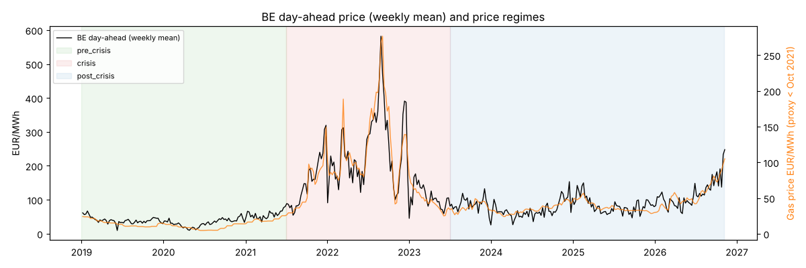
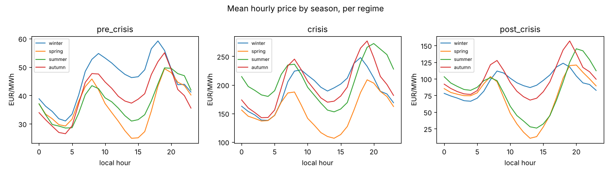
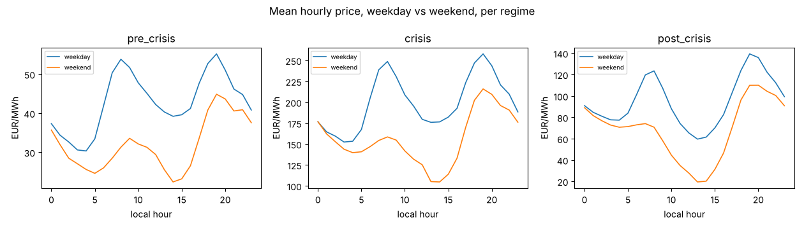
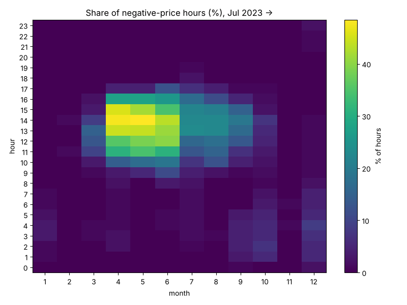
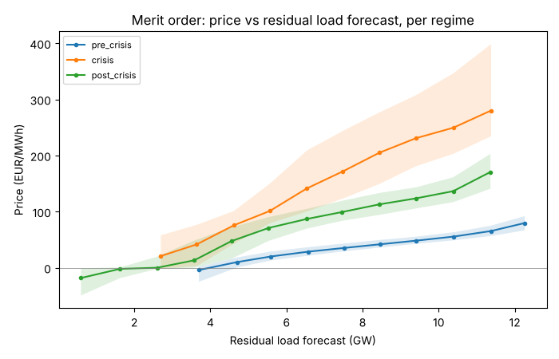
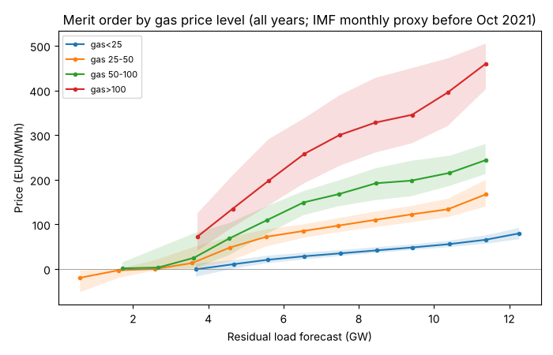

# EDA — Belgian day-ahead price (T11)

Generated by `python scripts/run_eda.py` on `dataset_clean.parquet` (68,759 hours, 2019-01-01 → 2026-11-04, Europe/Brussels local time). Descriptive statistics only — no causal claims, nothing here feeds the models.

## Key insights (real data, 2019-01 → 2026-11)

<!-- INSIGHTS:START -->
1. **The gas price tracks the price level; the regimes are mostly a gas story.** Mean BE price was 39.8 EUR/MWh before the crisis (2019 → Jun 2021), 187.6 during it (Jul 2021 → Jun 2023, std 122.2, p95 434.7) and 87.6 after it (Jul 2023 → 4 Nov 2026). On daily means, using only the THE VTP daily gas price (`ttf_gas` from Oct 2021, D-25; the monthly-proxy period is excluded), the correlation with the BE price is 0.87 over Oct 2021 → Nov 2026, 0.83 inside the crisis regime and 0.63 inside the post-crisis regime. So gas follows the level both across and within regimes, more weakly since mid-2023. At the hourly level the same correlations are lower (0.77 crisis, 0.46 post-crisis), because a daily gas value cannot follow the intraday shape. BE is tightly coupled to its neighbours (same-hour Pearson 0.98 with NL, 0.96 with DE-LU, 0.94 with FR), but these prices can be used only as lags (>= 24 h).
2. **The merit-order curve gets steeper when gas is expensive.** The OLS slope of price on the residual-load forecast is 8.1 EUR/MWh per GW pre-crisis, 34.9 in the crisis and 18.3 post-crisis. The pre-crisis slope rests mostly on the `fc_*` fallback for the solar forecast (15,334 of 21,886 hours, because there is no Elia 11AM solar data before Oct 2020). Pooled by gas price level (`ttf_gas`: IMF monthly proxy to Sep 2021, THE VTP daily after, D-25) the slope rises monotonically: 7.5 (gas < 25, 97% of its hours on the monthly proxy), 17.6 (25–50), 26.9 (50–100) and 43.2 (> 100). The linear fit explains only part of the variance (R² 0.26–0.57). Residual load × gas price is therefore a candidate interaction that needs an ablation (D-15), not an explanation.
3. **Solar has reshaped the daily profile into a "duck curve".** Pre-crisis spring prices ranged from 24.9 (14:00) to 49.4 (19:00), a 24.5 EUR/MWh spread. Post-crisis the spring trough is 10.6 at 13:00 against a peak of 120.7 at 20:00 (spread 110.0); summer: 25.9 at 14:00 vs 145.1 at 20:00. Weekends deepen the trough (post-crisis weekend minimum 19.5 at 13:00 vs 59.6 on weekdays). Within the post-crisis regime, the Elia 11AM solar forecast has the strongest same-hour correlation of the issue-time drivers (−0.41).
4. **Negative prices are now a regular, solar-driven event.** Negative hours rose from 71 (2019) to 404 (2024) and 519 (2025); 2026 already counts 307 by 4 Nov. Of the 1,930 negative hours since 2019, 72% fall between 11:00 and 16:00 local and 63% in April–July. Post-crisis, 4.7% of hours are negative (1.4% in both earlier regimes). The share depends strongly on the Elia 11AM forecast of (wind + solar) / load forecast: ≤ 0.3% below 40%, 6.6% at 40–60%, 34.9% at 60–80%, 72.5% at 80–100% and 90.5% above 100%. A solar forecast above 6 GW gives a median price of 0.4 EUR/MWh (42.4% negative). Prices at or below −400 EUR/MWh (SDAC floor −500) occurred on 4 days: 2019-06-08, 2025-05-11, 2026-04-26 and 2026-05-01.
5. **Late 2026 does not look "post-crisis" any more.** The monthly mean gas price (`ttf_gas` = THE VTP daily, stored with the 2-day publication lag) climbs from 45.3 (Jun 2026) to 84.4 (Oct) and 103.9 (1–4 Nov). BE prices follow: 112.1 → 174.2 → 248.3 EUR/MWh, with NL, FR and DE-LU moving in lockstep, so this is a regional move and not a BE data error. The last folds of the current backtest (Nov 2025 → Oct 2026) therefore fall in a period of rising gas prices that the training window has only seen in 2021–2022. The regime labels here are fixed calendar cut points, not estimated change points, and should be revisited.

_Caveats._ All correlations are same-hour (or same-day) and descriptive. Lag-only columns (prices, actual generation) and the ENTSO-E `fc_*` series (Elia 6PM run, published ~18:00 D-1) are **not** usable at the D-1 11:00 issue time: `fc_*` are baseline-only and must never be features (D-16 / D-29). `ttf_gas` and `eua_carbon` are stored already shifted by the 2-day publication lag. `ttf_gas` is not TTF for most of the history: pre-crisis gas statistics (regime justification, the gas < 25 slope bin, the hourly gas correlations) rest on a monthly IMF proxy that is constant within each month. The residual load uses the Elia 11AM run, with an `fc_*` fallback for 2019 → Sep 2020 (no Elia solar data). Weather columns are ERA5 reanalysis (optimistic). The spike flag (|robust 28-day z| > 6) adapts to local volatility, so it flags fewer hours in the crisis (0.1%) than before it (0.5%).
<!-- INSIGHTS:END -->

## 1. Price regimes

Regime boundaries (local dates, start inclusive; see `eda.REGIMES` for the justification): `pre_crisis` from 2019-01-01, `crisis` from 2021-07-01, `post_crisis` from 2023-07-01. Spikes = `flag_price_spike` from `validation.clean` (|robust rolling 28-day z| > 6, both tails, so deep negative dips count as spikes too).

**Gas price caveat (D-25).** `ttf_gas` is *not* TTF for most of the history: it is the IMF monthly EU gas proxy from 2019 to Sep 2021 (`flag_gas_monthly_proxy` = 1 up to 2021-10-03), the THE VTP daily average (German hub) from Oct 2021, and Yahoo TTF closes only recently. It is called "gas price" below; pre-crisis gas statistics rest on a monthly value, constant within each month.

| regime | start | end | hours | mean | median | std | p5 | p95 | spike_share_pct | negative_share_pct |
|---|---|---|---|---|---|---|---|---|---|---|
| pre_crisis | 2019-01-01 | 2021-06-30 | 21886 | 39.8 | 38.5 | 20.7 | 12.3 | 74.9 | 0.5 | 1.4 |
| crisis | 2021-07-01 | 2023-06-30 | 17520 | 187.6 | 160.9 | 122.2 | 42.9 | 434.7 | 0.1 | 1.4 |
| post_crisis | 2023-07-01 | 2026-11-04 | 29353 | 87.6 | 87.9 | 55.2 | 0.0 | 175.0 | 0.3 | 4.7 |

Per calendar year (2026 is partial, up to the dataset end):

| year | hours | mean | median | std | negative_hours | min | max |
|---|---|---|---|---|---|---|---|
| 2019 | 8759 | 39.3 | 38.9 | 18.0 | 71 | -500.0 | 121.5 |
| 2020 | 8784 | 31.9 | 31.5 | 16.5 | 136 | -115.3 | 200.0 |
| 2021 | 8760 | 104.1 | 77.9 | 79.4 | 159 | -70.0 | 620.0 |
| 2022 | 8760 | 244.5 | 219.8 | 134.7 | 112 | -100.0 | 871.0 |
| 2023 | 8760 | 97.3 | 98.7 | 45.9 | 222 | -120.0 | 330.4 |
| 2024 | 8784 | 70.3 | 71.6 | 43.0 | 404 | -140.0 | 565.5 |
| 2025 | 8760 | 82.6 | 86.7 | 47.6 | 519 | -462.3 | 517.6 |
| 2026 | 7392 | 115.8 | 114.9 | 70.2 | 307 | -497.9 | 933.3 |

Monthly means, last 16 months (the last month is partial). Read this before trusting the `post_crisis` label for the most recent folds:

| month | price_da | price_da_NL | price_da_FR | price_da_DE_LU | ttf_gas | eua_carbon |
|---|---|---|---|---|---|---|
| 2025-08 | 69.0 | 74.6 | 54.4 | 77.0 | 33.3 | 71.2 |
| 2025-09 | 63.6 | 77.6 | 34.8 | 83.5 | 32.4 | 75.2 |
| 2025-10 | 75.1 | 82.3 | 57.5 | 84.4 | 32.8 | 77.9 |
| 2025-11 | 86.2 | 93.7 | 59.1 | 101.9 | 32.2 | 80.4 |
| 2025-12 | 85.4 | 87.7 | 68.7 | 93.5 | 29.2 | 83.8 |
| 2026-01 | 108.5 | 107.6 | 100.7 | 110.1 | 35.0 | 86.4 |
| 2026-02 | 85.1 | 92.9 | 46.0 | 96.6 | 35.9 | 74.0 |
| 2026-03 | 92.6 | 98.9 | 63.9 | 99.3 | 51.4 | 68.1 |
| 2026-04 | 78.9 | 84.6 | 39.8 | 78.5 | 46.9 | 72.1 |
| 2026-05 | 91.8 | 94.9 | 52.2 | 97.5 | 47.3 | 74.2 |
| 2026-06 | 112.1 | 110.1 | 66.1 | 109.5 | 45.3 | 77.4 |
| 2026-07 | 109.2 | 105.9 | 95.2 | 105.4 | 52.1 | 79.5 |
| 2026-08 | 129.3 | 125.4 | 122.8 | 126.9 | 61.3 | 80.8 |
| 2026-09 | 156.4 | 152.2 | 143.3 | 144.8 | 75.6 | 84.1 |
| 2026-10 | 174.2 | 171.8 | 165.8 | 169.3 | 84.4 | 85.0 |
| 2026-11 | 248.3 | 247.8 | 246.0 | 254.3 | 103.9 | 88.2 |

## 2. Daily profiles

Mean price by local hour. Shape descriptors (peak/trough hour, spread = peak − trough):

| regime / season | peak_hour | peak | trough_hour | trough | spread |
|---|---|---|---|---|---|
| pre_crisis / winter | 18 | 59.1 | 4 | 31.0 | 28.2 |
| pre_crisis / spring | 19 | 49.4 | 14 | 24.9 | 24.5 |
| pre_crisis / summer | 19 | 49.7 | 4 | 28.5 | 21.2 |
| pre_crisis / autumn | 19 | 55.0 | 4 | 26.5 | 28.5 |
| crisis / winter | 18 | 247.8 | 4 | 137.8 | 110.0 |
| crisis / spring | 19 | 208.9 | 14 | 106.5 | 102.4 |
| crisis / summer | 20 | 272.4 | 14 | 152.7 | 119.6 |
| crisis / autumn | 19 | 276.9 | 3 | 142.5 | 134.4 |
| post_crisis / winter | 18 | 123.3 | 4 | 66.2 | 57.1 |
| post_crisis / spring | 20 | 120.7 | 13 | 10.6 | 110.0 |
| post_crisis / summer | 20 | 145.1 | 14 | 25.9 | 119.1 |
| post_crisis / autumn | 19 | 156.8 | 13 | 68.0 | 88.8 |

| regime / daytype | peak_hour | peak | trough_hour | trough | spread |
|---|---|---|---|---|---|
| pre_crisis / weekday | 19 | 55.2 | 4 | 30.3 | 24.9 |
| pre_crisis / weekend | 19 | 44.9 | 14 | 22.4 | 22.5 |
| crisis / weekday | 19 | 258.0 | 3 | 152.5 | 105.5 |
| crisis / weekend | 19 | 216.0 | 14 | 104.7 | 111.3 |
| post_crisis / weekday | 19 | 139.4 | 13 | 59.6 | 79.8 |
| post_crisis / weekend | 20 | 110.1 | 13 | 19.5 | 90.6 |

## 3. Negative prices

Count of negative-price hours per year, local hour of day and month (all years):

|  | 2019 | 2020 | 2021 | 2022 | 2023 | 2024 | 2025 | 2026 |
|---|---|---|---|---|---|---|---|---|
| negative_hours | 71 | 136 | 159 | 112 | 222 | 404 | 519 | 307 |

|  | 0 | 1 | 2 | 3 | 4 | 5 | 6 | 7 | 8 | 9 | 10 | 11 | 12 | 13 | 14 | 15 | 16 | 17 | 18 | 19 | 20 | 21 | 22 | 23 |
|---|---|---|---|---|---|---|---|---|---|---|---|---|---|---|---|---|---|---|---|---|---|---|---|---|
| negative_hours | 10 | 29 | 42 | 59 | 64 | 46 | 29 | 26 | 20 | 41 | 100 | 176 | 225 | 276 | 299 | 255 | 161 | 50 | 8 | 2 | 2 | 2 | 3 | 5 |

|  | 1 | 2 | 3 | 4 | 5 | 6 | 7 | 8 | 9 | 10 | 11 | 12 |
|---|---|---|---|---|---|---|---|---|---|---|---|---|
| negative_hours | 34 | 23 | 134 | 334 | 349 | 308 | 224 | 196 | 128 | 102 | 9 | 89 |

Conditional on the Elia day-ahead 11AM forecasts, post-crisis regime only (the 11AM run is available at the issue time; solar starts 2020-10):

Solar forecast (MW):

| elia_solar_dayahead11hforecast | hours | negative_share_pct | median_price |
|---|---|---|---|
| (-0.001, 500.0] | 17992 | 0.9 | 94.5 |
| (500.0, 1000.0] | 1939 | 0.5 | 101.5 |
| (1000.0, 2000.0] | 2738 | 2.0 | 90.3 |
| (2000.0, 3000.0] | 2083 | 6.7 | 75.0 |
| (3000.0, 4000.0] | 1671 | 13.3 | 58.0 |
| (4000.0, 5000.0] | 1265 | 19.1 | 42.5 |
| (5000.0, 6000.0] | 855 | 26.8 | 19.3 |
| (6000.0, 9000.0] | 786 | 42.4 | 0.4 |

Wind forecast (MW):

| elia_wind_dayahead11hforecast | hours | negative_share_pct | median_price |
|---|---|---|---|
| (-0.001, 500.0] | 8856 | 3.9 | 98.2 |
| (500.0, 1000.0] | 5367 | 3.4 | 97.6 |
| (1000.0, 2000.0] | 5938 | 4.1 | 89.8 |
| (2000.0, 3000.0] | 4481 | 4.8 | 76.5 |
| (3000.0, 4000.0] | 3467 | 8.4 | 64.5 |
| (4000.0, 6000.0] | 1196 | 8.8 | 44.7 |

(Wind + solar forecast) / load forecast (%):

|  | hours | negative_share_pct | median_price |
|---|---|---|---|
| (-0.001, 20.0] | 12431 | 0.0 | 107.5 |
| (20.0, 40.0] | 9109 | 0.3 | 86.3 |
| (40.0, 60.0] | 5397 | 6.6 | 53.3 |
| (60.0, 80.0] | 1919 | 34.9 | 4.4 |
| (80.0, 100.0] | 407 | 72.5 | -4.7 |
| (100.0, 200.0] | 42 | 90.5 | -49.1 |

## 4. Merit order: price vs residual load

Residual load forecast = `load_forecast` − `elia_wind_dayahead11hforecast` − `elia_solar_dayahead11hforecast`. **Fallback**: where the Elia 11AM run is missing, the ENTSO-E `fc_*` series (Elia 6PM run) is used instead — 22.4% of hours (2019: 8,759 h, 2020: 6,575 h, 2026: 48 h; the Elia solar series starts 2020-10, the 2026 hours are short Elia gaps). This is fine for description, but `fc_*` are baseline-only and must never be model features (D-16 / D-29).

OLS slope of the hourly price on the residual load (EUR/MWh per GW), per regime. `fc_fallback_hours` = hours whose residual load uses the `fc_*` 6PM-run fallback: the pre-crisis slope rests mostly on them.

|  | slope_eur_per_gw | intercept | r2 | hours | fc_fallback_hours |
|---|---|---|---|---|---|
| pre_crisis | 8.09 | -23.86 | 0.39 | 21886 | 15334 |
| crisis | 34.93 | -63.13 | 0.26 | 17520 | 0 |
| post_crisis | 18.33 | -32.97 | 0.45 | 29353 | 48 |

Same slope by gas price level (`ttf_gas`: IMF monthly proxy to Sep 2021, THE VTP daily after, D-25; all years pooled; the dataset value is already the D-2 close, `commodities.publication_lag_days`). `gas_proxy_hours` = hours where the gas value is the monthly proxy:

|  | slope_eur_per_gw | intercept | r2 | hours | gas_proxy_hours |
|---|---|---|---|---|---|
| gas<25 | 7.54 | -19.79 | 0.37 | 21768 | 21216 |
| gas 25-50 | 17.60 | -33.26 | 0.54 | 30528 | 2928 |
| gas 50-100 | 26.86 | -39.06 | 0.57 | 10896 | 0 |
| gas>100 | 43.18 | -17.10 | 0.26 | 5567 | 0 |

Binned median price per 1-GW residual-load bin (bins with < 50 hours dropped):

| bin | pre_crisis | crisis | post_crisis |
|---|---|---|---|
| (0.0, 1.0] |  |  | -18.3 |
| (1.0, 2.0] |  |  | -2.0 |
| (2.0, 3.0] |  | 20.8 | 0.0 |
| (3.0, 4.0] | -4.0 | 41.6 | 13.2 |
| (4.0, 5.0] | 10.0 | 75.8 | 47.4 |
| (5.0, 6.0] | 20.1 | 101.3 | 70.9 |
| (6.0, 7.0] | 28.6 | 141.4 | 86.9 |
| (7.0, 8.0] | 35.3 | 171.8 | 99.2 |
| (8.0, 9.0] | 41.9 | 205.0 | 112.9 |
| (9.0, 10.0] | 48.3 | 230.8 | 123.6 |
| (10.0, 11.0] | 55.6 | 249.5 | 136.4 |
| (11.0, 12.0] | 65.4 | 280.2 | 170.6 |
| (12.0, 13.0] | 79.7 |  |  |

## 5. Correlations with core drivers

Same-hour correlations with `price_da`; candidate families (D-24: `nb_`, `unav_`, `xch_`, `fb_`, `cap_BE_`, `hydro_res_`, `wfr_`, `cmd_`, `flag_`, other `elia_` runs) excluded. `availability` says how the column may enter the model at the D-1 11:00 issue time — a same-hour correlation of a lag-only or baseline-only column is **not** usable information as such.

|  | pearson | spearman | pearson_pre_crisis | pearson_crisis | pearson_post_crisis | availability |
|---|---|---|---|---|---|---|
| price_da_NL | 0.98 | 0.97 | 0.88 | 0.97 | 0.96 | lag >= 24h |
| price_da_DE_LU | 0.96 | 0.95 | 0.87 | 0.96 | 0.93 | lag >= 24h |
| price_da_FR | 0.94 | 0.91 | 0.90 | 0.92 | 0.88 | lag >= 24h |
| ttf_gas | 0.82 | 0.74 | 0.48 | 0.77 | 0.46 | stored with 2-day lag (monthly proxy < Oct 2021) |
| eua_carbon | 0.49 | 0.61 | 0.45 | 0.16 | 0.29 | stored with 2-day lag |
| gen_biomass_waste | 0.39 | 0.22 | 0.25 | 0.42 | -0.09 | lag >= 48h |
| gen_gas | 0.37 | 0.33 | 0.53 | 0.56 | 0.63 | lag >= 48h |
| gen_hydro | 0.23 | 0.26 | 0.25 | 0.19 | 0.35 | lag >= 48h |
| elia_solar_dayahead11hforecast | -0.23 | -0.16 | -0.04 | -0.13 | -0.41 | same-time |
| w_brussels_wind_speed_100m | -0.21 | -0.23 | -0.25 | -0.30 | -0.29 | same-time (ERA5 proxy) |
| w_antwerp_wind_speed_100m | -0.21 | -0.23 | -0.26 | -0.30 | -0.29 | same-time (ERA5 proxy) |
| w_liege_wind_speed_100m | -0.21 | -0.22 | -0.22 | -0.30 | -0.28 | same-time (ERA5 proxy) |
| w_offshore_wind_zone_wind_speed_100m | -0.20 | -0.21 | -0.24 | -0.30 | -0.27 | same-time (ERA5 proxy) |
| fc_gen_total | 0.19 | 0.10 | 0.34 | 0.30 | -0.07 | baseline-only (6PM run) |
| gen_wind | -0.17 | -0.15 | -0.22 | -0.32 | -0.26 | lag >= 48h |
| load_forecast | 0.16 | 0.19 | 0.52 | 0.27 | 0.22 | same-time |
| load_actual | 0.16 | 0.19 | 0.55 | 0.28 | 0.22 | lag >= 48h |
| elia_wind_dayahead11hforecast | -0.16 | -0.14 | -0.20 | -0.34 | -0.29 | same-time |
| fc_wind | -0.16 | -0.14 | -0.20 | -0.34 | -0.28 | baseline-only (6PM run) |
| gen_solar | -0.16 | -0.11 | -0.14 | -0.13 | -0.40 | lag >= 48h |
| fc_solar | -0.16 | -0.11 | -0.14 | -0.13 | -0.40 | baseline-only (6PM run) |
| w_liege_shortwave_radiation | -0.15 | -0.12 | -0.14 | -0.12 | -0.38 | same-time (ERA5 proxy) |
| w_antwerp_shortwave_radiation | -0.15 | -0.12 | -0.14 | -0.11 | -0.37 | same-time (ERA5 proxy) |
| w_brussels_shortwave_radiation | -0.15 | -0.12 | -0.14 | -0.11 | -0.37 | same-time (ERA5 proxy) |
| w_offshore_wind_zone_shortwave_radiation | -0.14 | -0.12 | -0.14 | -0.11 | -0.37 | same-time (ERA5 proxy) |
| gen_storage | 0.13 | 0.15 |  |  | 0.42 | lag >= 48h |
| gen_nuclear | 0.06 | -0.03 | 0.24 | 0.05 | -0.24 | lag >= 48h |
| gen_total | 0.05 | -0.08 | 0.31 | 0.14 | -0.26 | lag >= 48h |
| w_liege_temperature_2m | -0.05 | -0.12 | -0.18 | -0.01 | -0.13 | same-time (ERA5 proxy) |
| w_offshore_wind_zone_temperature_2m | 0.05 | -0.02 | -0.18 | 0.10 | -0.01 | same-time (ERA5 proxy) |
| w_brussels_temperature_2m | -0.04 | -0.11 | -0.19 | -0.01 | -0.12 | same-time (ERA5 proxy) |
| w_antwerp_temperature_2m | -0.04 | -0.11 | -0.19 | -0.01 | -0.13 | same-time (ERA5 proxy) |
| w_offshore_wind_zone_cloud_cover | 0.02 | 0.06 | 0.07 | -0.01 | 0.00 | same-time (ERA5 proxy) |
| w_liege_cloud_cover | -0.01 | 0.04 | 0.08 | -0.04 | -0.07 | same-time (ERA5 proxy) |
| w_antwerp_cloud_cover | -0.01 | 0.04 | 0.07 | -0.04 | -0.05 | same-time (ERA5 proxy) |
| w_brussels_cloud_cover | -0.00 | 0.04 | 0.07 | -0.03 | -0.05 | same-time (ERA5 proxy) |

Gas price vs `price_da` on **daily means**, excluding the monthly-proxy hours (i.e. THE VTP daily price, Oct 2021 onward) and hours without a price:

|  | start | end | days | pearson |
|---|---|---|---|---|
| all | 2021-10-03 | 2026-11-04 | 1859 | 0.87 |
| crisis | 2021-10-03 | 2023-06-30 | 636 | 0.83 |
| post_crisis | 2023-07-01 | 2026-11-04 | 1223 | 0.63 |
